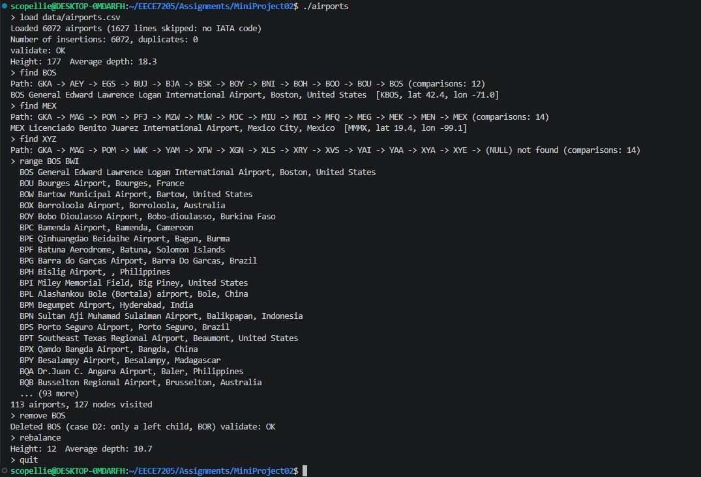

# airport-bst-cpp

An airport lookup service built on my own binary search tree, keyed by the three-letter IATA code
(BOS, JFK, DAC). It loads the OpenFlights airport list, then supports search, insert, delete,
alphabetical listing, range queries, and a study of how insertion order changes the tree's height.

## Project layout

```
airport-bst-cpp/
├── airport_bst.cpp          the whole program (Airport and AirportBST classes, commands, tests)
├── data/
│   └── airports.csv         OpenFlights airport data
├── docs/
│   └── pseudocode.md        pseudocode for every operation
├── media/
│   └── sample_session.mkv   screen recording of a session execution
│   └── sample_session.png   screenshot of a session execution
└── README.md
```

## Build and run

From the project root:

Start program without reading data file:
```
g++ -std=c++17 -O2 airport_bst.cpp -o airports
./airports
```

Automatically reading data file:
```
g++ -std=c++17 -O2 airport_bst.cpp -o airports
./airports data/airports.csv
```

## Commands

| Command | What it does |
|---|---|
| `load FILE` | Loads `airports.csv` and builds the tree in file order. Given a file written by `save`, rebuilds the tree from it instead. |
| `find CODE` | Prints the airport, the search path and the number of comparisons. |
| `minmax` | Prints the smallest and largest code. |
| `remove CODE` | Deletes an airport and reports the case (D1, D2 or D3). |
| `add CODE name\|city\|country` | Adds an airport. |
| `list [N]` | Alphabetical listing (inorder), with a sorted check. |
| `save FILE` | Writes the codes in preorder. |
| `validate` | Checks the BST property. |
| `range FROM TO` | Lists the airports from FROM to TO and the number of nodes visited. |
| `stats` | Prints the height and average depth. |
| `rebalance` | Rebuilds the tree balanced from the sorted array. |
| `experiment` | Prints the Task 6 table. |
| `test` | Runs the Task 2-5 walkthrough: every search case, every delete case, add and remove QQQ, sorted listing, save and reload, and `range BOS BWI`. |
| `quit` | Exits. |

A file written by `save` starts with a `#preorder` line, which is how `load` tells it apart from
the airport data. Load `data/airports.csv` first, because the saved file holds only codes and the
airport records come from the data.

## Sample session



Additional .mkv recording can be found in the media folder with a screen recording of the execution of a sample session.

## Task 6: the shape experiment

| Build order | Height | Average depth | Time for 10,000 searches | Explanation |
|---|---|---|---|---|
| File order | 177 | 18.3 | 1.99 ms | Original load order based on input file |
| Sorted order | 6071 | 3035.5 | 126.60 ms | Creates a linked list with 6072 nodes, searches have to go through every previous code |
| Balanced (middle rule) | 12 | 10.7 | 1.29 ms | Balances the nodes with a height of $log_2(6072)$ |
| Random shuffle (bonus) | 25 | 13.8 | 1.46 ms | Random load order, approaches average of $log_2(6072)$ with a certain degree of balance (significantly better than a linked list) |

## Pseudocode

See [docs/pseudocode.md](docs/pseudocode.md) for build, insert, search, delete, validate, range and
the balanced build.

## Data credit

Airport data from OpenFlights.org (https://openflights.org/data.php), published under the Open Database License.
